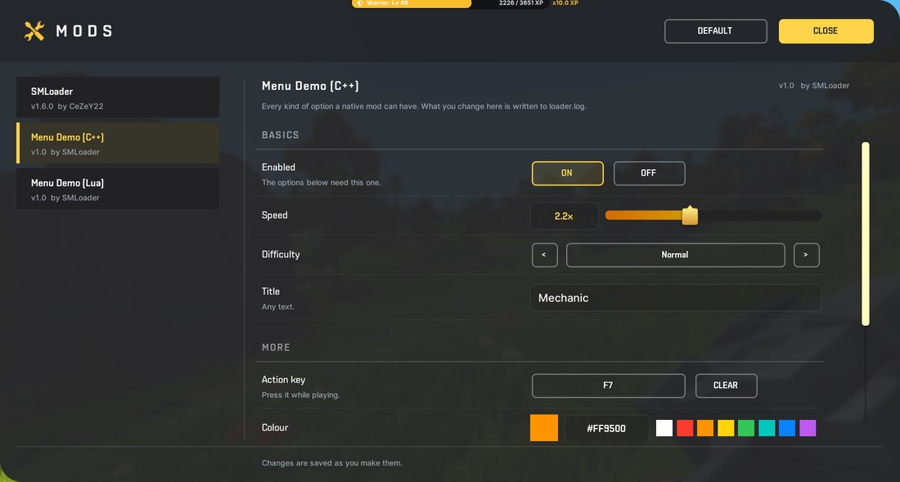

# SMLoader

A native (C++) mod loader for **Scrap Mechanic**. It loads DLL mods into the
game and gives them safe access to the game's Lua scripting, its scripts as
they load, and the screen, for menus and overlays.

- **For players:** drop in one file and your mods load automatically.
- **For modders:** a small C API (`include/smloader.h`) with examples, a live
  Lua console, a crash reporter, and **SMNetworking** for multiplayer mods that
  stay in sync ([guide](docs/NETWORKING.md)), and **SMPlayerData** for persistent
  player stats and progression ([guide](docs/PLAYERDATA.md)), and **SMEvents**, one
  event bus shared by Lua and C++ ([guide](docs/EVENTS.md)), and **SMExtensions**,
  more functionality for Lua: native functions, timers, hotkeys and per-mod files
  ([guide](docs/EXTENSIONS.md)), and **SMModsMenu**, a settings page for your mod
  in the game's pause menu ([guide](docs/MODSMENU.md)).

> Built for **Scrap Mechanic 1.0.7a** (Steam, Windows x64). Not affiliated
> with or endorsed by Axolot Games.

---

## Install (players)

1. Download `SMLoader-v1.6.0.zip` from **Releases**.
2. Open your game folder: Steam → right-click Scrap Mechanic → *Manage* →
   *Browse local files*.
3. Copy `Release\winmm.dll` into the game's `Release` folder (next to
   `ScrapMechanic.exe`).
4. Copy the `SMLoader` folder into the game folder (next to `Release`).
5. Put mod `.dll` files in `SMLoader\mods\` and start the game normally.

To check it worked, `SMLoader\loader.log` should start with `SMLoader 1.6.0 starting`.

**Change mod settings in the game:** press Esc and click **MODS**. Every mod that
supports it has its own page there. SMLoader's page has the switches from
`loader.ini` and turns mods on and off.



**Uninstall:** delete `Release\winmm.dll`. Steam's "verify files" won't remove
it for you.

### Folder layout

```
Scrap Mechanic\
├─ Release\
│  ├─ ScrapMechanic.exe
│  └─ winmm.dll          ← SMLoader
└─ SMLoader\
   ├─ mods\              ← mod DLLs
   ├─ config\            ← settings from the MODS page
   ├─ overrides\         ← optional script replacements (see below)
   ├─ loader.ini         ← created on first run
   └─ loader.log         ← what happened (and crash reports)
```

`loader.ini`:

| Key | Default | Meaning |
|---|---|---|
| `LogScriptLoads` | `0` | Log every Lua script the game compiles (handy when modding) |
| `EnableOverrides` | `1` | Replace game scripts with files from `SMLoader\overrides\` |
| `LoadMods` | `1` | Load DLLs from `SMLoader\mods\` |
| `Achievements` | `1` | Keep Steam achievements working when a mod changes the game's data. `0` = the game's own rule: no achievements while its data files are modified |

`[fixes]` section:

| Key | Default | Meaning |
|---|---|---|
| `NetworkFix` | `1` | When you join someone's world, handle network packets as they arrive instead of postponing them |
| `FastPhysics` | `1` | Faster constraint solver for big creations, same results (needs a CPU with AVX2) |
| `PhysicsVerify` | `0` | For testing: check this many solves against the game's own solver and log the difference |
| `PhysicsLogSeconds` | `0` | For testing: log solver statistics every so many seconds |

## Built-in fixes

Things the game could do better, fixed by the loader. Each one checks the
game's code first and leaves it alone if it isn't the code it knows.

- **Network fix** (for players who join a world): the game postpones some
  packets to a later tick, so a joined player can fall further and further
  behind the host. With the fix, packets are handled as they arrive. It does
  nothing for the host. Not yet tested in co-op on 1.0.7a.
- **Fast physics:** the game's exact joint and contact solver is replaced by a
  faster build of the same algorithm. Measured on 1.0.7a with a 43-body,
  93-joint vehicle: about 3 times faster (5.4 → 1.7 ms per solve), with results
  within 0.1% of the game's. It helps when that solver is what costs time, for
  example big creations with many bearings and pistons in motion; other causes
  of lag are not affected. If it can't solve a problem, the game's solver does.

Credits and licences: [THIRD_PARTY_NOTICES.md](THIRD_PARTY_NOTICES.md).

---

## Make a mod

### 1. Build the examples

You need **Visual Studio 2022 or 2026** (or the free Build Tools) with
*Desktop development with C++*.

```powershell
git clone <this repo>
cd SMLoader
.\build.ps1 -Install      # builds winmm.dll + examples, installs the loader
```

`build.ps1` finds the game through Steam (or pass `-GameDir "<path>"`).
Every folder under `examples\` becomes `<FolderName>.dll` in `build\`.
Copy the ones you want into `SMLoader\mods\`.

### 2. Start from HelloMod

```cpp
#include "../../include/smloader.h"

static const SMLoaderAPI* api;

extern "C" __declspec(dllexport) void SMMod_Init(const SMLoaderAPI* a) {
    if (a->version < SMLOADER_API_VERSION) return;
    api = a;
    static SMModCallbacks cb{};
    cb.OnGameTick = [](lua_State* L, void*) { /* game's Lua thread, safe point */ };
    api->RegisterCallbacks(&cb);
    api->Log("my mod loaded");
}
```

[`examples/HelloMod`](examples/HelloMod/HelloMod.cpp) is a complete, commented
mod that posts a chat message when you join a Survival world. Copy its folder,
rename it, and build.

### 3. The API at a glance

| Function | What it's for |
|---|---|
| `RegisterCallbacks` | `OnStateCreated`, `OnStateClosed`, `OnScriptLoad`, `OnGameTick` |
| `QueueLua(L, src, name, env, done)` | Run Lua in a game state at the next safe point. `env` is `"game"` (the scripts' shared env) or `NULL` (raw globals) |
| `QueueLuaIn(L, "SurvivalGame.client_onUpdate", src, ...)` | Run Lua **inside** a game callback, where `sm.*` calls are allowed. `...` holds the callback's arguments (`self`, `dt`) |
| `QueueJob(L, fn)` | Run your C function on the game's Lua thread |
| `lua->...` | The LuaJIT C API (original, unhooked functions) |
| `OnScriptLoad` | See or rewrite every script the game compiles |
| `PatchImport(dll, func, hook, &orig)` | Redirect a function the game imports. Hooks from several mods chain |
| `AddPresentCallback(fn)` | Draw on screen every frame (e.g. a Dear ImGui menu) |
| `AddCallbackHook("SurvivalGame.server_onFixedUpdate", "MyMod.tick")` | Run your Lua function before a game callback, without wrapping it (several mods can share a callback) |
| `ExtRegister` / `ExtRegisterRaw` / `ExtToken` / `WorldState` | **SMExtensions**: expose your C++ functions to Lua (`SMX.fn.mymod.fn(...)`), give your Lua its private file folder, get the world's Lua state ([guide](docs/EXTENSIONS.md)) |
| `EventOn` / `EventOff` / `EventEmit` / `EventEmitTo` | **SMEvents**: subscribe to and emit events shared with Lua mods and the SDK (`robot.killed`, `player.joined`, ...). Lua mods use the `SMEvents` table ([guide](docs/EVENTS.md)) |
| `ContentAdd` / `ContentEdit` / `ContentAddIcon` | **SMContent**: add items, recipes, texts and icons to the game in memory ([guide](docs/CONTENT.md)) |
| `AudioAdd` | **SMAudio**: play your own sound files in 3D through the game's sound engine, from Lua with `SMAudio.play` ([guide](docs/AUDIO.md)) |
| `DataGet` / `DataSet` / `DataAdd` / `DataAddXP` / `DataUnlock` | **SMPlayerData**: per-player stats, mod data, XP and unlocks saved in the world. Lua mods use the `SMData` table ([guide](docs/PLAYERDATA.md)) |
| `MenuAddPage` / `MenuAddOption` / `MenuGetNumber` / ... | **SMModsMenu**: your mod's settings in the pause menu's MODS page, saved for you. Lua mods use the `SMModsMenu` table ([guide](docs/MODSMENU.md)) |
| `NetRegister` / `NetOn` / `NetSend` / `NetGetStatus` | **SMNetworking**: multiplayer messages, a roster and the "does everyone have my mod?" check. Lua mods use the `SMNet` table instead ([guide](docs/NETWORKING.md)) |

Full reference: [docs/API.md](docs/API.md).

### 4. Rules that save you hours

- **Only touch a `lua_State` from loader callbacks or queued jobs.** The game
  drives its gameplay state from several threads, and the loader runs your
  work on whichever thread currently owns it.
- **Most `sm.*` functions need a callback context.** Outside one, the game
  says *"Sandbox violation: callback while no sandbox is present"*. Use
  `QueueLuaIn` with a client callback (`SurvivalGame.client_onUpdate`) or a
  server one (`SurvivalGame.server_onFixedUpdate`, host only).
- **Physics and creation calls need a world script.** The game-mode script
  gets *"Calling world dependent functions in a no world script!"*. Use a
  player-script callback such as `SurvivalPlayer.server_onFixedUpdate`.
- **Game classes live in one shared env** (`"game"`). It inherits a whitelist
  called `unsafe_env`, so `getfenv`, `rawget`, `debug` and the like are missing
  there. The raw globals (`env = NULL`) have them, but the global `type` is
  the game's own replacement.
- **The engine looks callbacks up by name on every call**, so wrapping a class
  method at runtime (`SurvivalGame.server_onFixedUpdate = myWrapper`) works.
- **Don't create D3D devices while the game is starting**, and don't hook
  `ResizeBuffers`. Use `AddPresentCallback`; the loader handles timing and the
  Steam overlay.
- If the game crashes, `loader.log` contains the crashing module and a stack
  trace.

### 5. Developer tools

- **LuaConsole** ([examples/LuaConsole](examples/LuaConsole/LuaConsole.cpp)):
  a console window that runs Lua inside the live game. `:help` lists the
  commands, and `:ctx client|server|none` picks where the code runs.
- **`tools\smexec.ps1`**: run Lua in the game from a terminal through
  LuaConsole's pipe (`\\.\pipe\SMLoaderConsole`). For example:
  ```powershell
  .\tools\smexec.ps1 -Ctx client 'sm.localPlayer.getPlayer().character.worldPosition'
  ```
- **Script overrides**: to replace a game script without touching game files,
  put your version at the matching path. For example
  `SMLoader\overrides\SURVIVAL_DATA\Scripts\game\SurvivalPlayer.lua` replaces
  `$SURVIVAL_DATA/Scripts/game/SurvivalPlayer.lua`.
- **DevCommands** ([examples/DevCommands](examples/DevCommands/DevCommands.cpp)):
  an example of patching a script as it loads. It turns on Survival's built-in
  developer chat commands in worlds you host, without touching quests or the
  normal start.

---

## How it works

1. **Entry.** The game imports `winmm.dll`, which isn't a protected system DLL,
   so Windows loads ours from the game folder. All 181 real `winmm` exports are
   forwarded to `System32`.
2. **Lua hooks.** The loader patches the game's import table for `lua51.dll`
   (LuaJIT 2.1): `luaL_newstate`, `lua_close`, `luaL_loadbufferx`, `lua_pcall`.
   It doesn't patch game code or depend on game memory addresses.
3. **Safe points.** Queued work runs right before the game's outermost
   `lua_pcall`, on the thread driving that state. `QueueLuaIn` waits until
   that call is the named callback, so your code runs inside its sandbox.
4. **Overlays.** One `IDXGISwapChain::Present` hook serves all mods, and it
   always ends at the real `dxgi` function, resolved from `dxgi.dll` on disk.
   This avoids endless recursion with the Steam overlay.
5. **Crash reports.** A first-chance exception handler writes the faulting
   module and a stack trace to `loader.log`.

What we learned about how the game runs Lua is written up in
[docs/REVERSE_ENGINEERING.md](docs/REVERSE_ENGINEERING.md).

---

## Responsible use

Mods run with the same rights as the game. Only install mods you trust. Keep
server-side changes to worlds you host, or to friends who agree.

## License

[MIT](LICENSE) © 2026 CeZeY22
