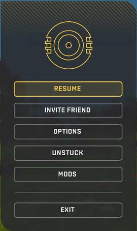
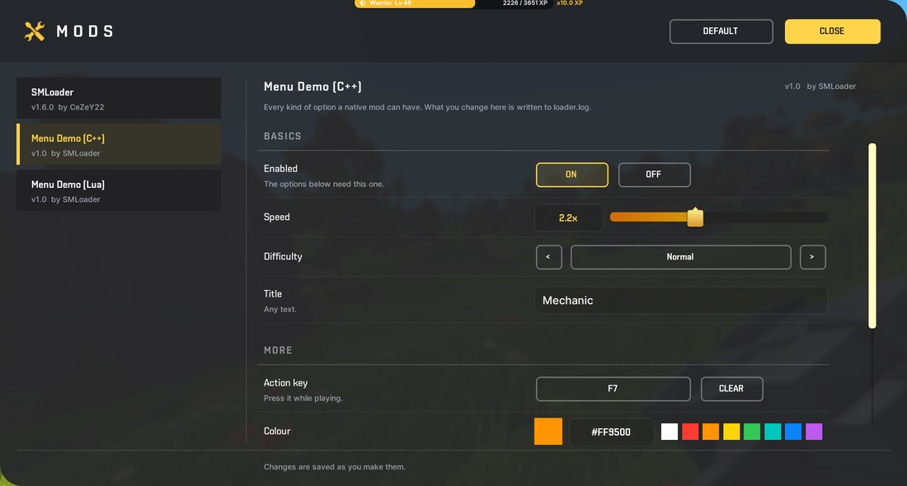

# SMModsMenu

SMLoader 1.6 adds a **MODS** button to the game's pause menu, under UNSTUCK. It
opens a page that looks like the game's own Options, with a list of mods on the
left and the chosen mod's settings on the right. Any mod can have a page there.
SMLoader draws it, saves the values and tells your mod when one changes, so you
don't need a config file or a menu of your own.




| | |
|---|---|
| **Options** | on/off, slider, choice, text, key, colour, button, plus headings and paragraphs |
| **From Lua** | the global table `SMModsMenu` |
| **From C++** | `api->MenuAddPage`, `api->MenuAddOption`, ... (API version 5) |
| **Saved** | per PC, in `SMLoader\config\<page id>.cfg`, as soon as the player changes something |
| **Co-op** | options can follow the host: one value for everyone in the world |
| **Where** | Survival, Creative and Challenge (custom games whose game class SMNetworking knows) |

A complete example with every option type, in both languages:
[`examples/MenuDemo`](../examples/MenuDemo/MenuDemo.cpp).

## Lua

Run this once per world, for example from the script your mod installs with
`QueueLua` when `world.loaded` arrives:

```lua
local page = SMModsMenu.page{
	id = "mymod", name = "My Mod", version = "1.0", author = "Me",
	description = "What it does, in a sentence." }

page:section( "JUMPING" )
page:toggle{ id = "enabled", label = "Super jump", default = true,
	onChange = function( on ) print( "super jump is now", on ) end }
page:slider{ id = "height", label = "Jump height", min = 1, max = 10, step = 0.5, default = 3,
	format = "%.1f m", enabledBy = "enabled" }
page:choice{ id = "style", label = "Style", choices = { "Smooth", "Rocket", "Spring" }, default = "Rocket" }
page:key{ id = "key", label = "Jump key", default = "F6", onPress = function() doJump() end }
page:color{ id = "trail", label = "Trail colour", default = "#FF9500" }
page:text{ id = "name", label = "Trail name", default = "", max = 24 }
page:button{ id = "wipe", label = "Forget my records", caption = "FORGET", confirm = true,
	onClick = function() wipeRecords() end }
page:info( "Records are kept per world." )

-- anywhere in your mod:
if page:get( "enabled" ) then jump( page:get( "height" ) ) end
```

Creating a page again starts it over, so a script that is loaded twice doesn't
add its options twice. The saved values stay.

### Options

Every function returns the page, so calls can be chained. Ids are letters,
digits, `_`, `-` and `.`, up to 64 characters.

| Function | Value | Own fields |
|---|---|---|
| `page:toggle{}` | `true` / `false` | `default` (false) |
| `page:slider{}` | number | `min`, `max`, `step` (none: any value), `default` (min), `format` (`"%.1fx"`) or `unit` (`"%"`) |
| `page:choice{}` | the chosen value | `choices`: strings, numbers, or `{ value = , label = }`; `default` (the first). Two short choices are shown as two buttons |
| `page:text{}` | string | `default` (`""`), `max` (64 characters) |
| `page:key{}` | key name, `""` = none | `default`, `onPress( page )`. Names as in `SMX.input` (`"F6"`, `"G"`, `"MOUSE4"`) |
| `page:color{}` | `"#RRGGBB"` | `default` (`"#FFFFFF"`) |
| `page:button{}` | none | `onClick( page )`, `caption` (`"RUN"`), `confirm = true` asks first |
| `page:section( text )` | none | a heading |
| `page:info( text )` | none | a paragraph |

Fields every setting can have:

| Field | Meaning |
|---|---|
| `id`, `label` | the label may be a function that returns the text |
| `desc` | small text under the label (or a function) |
| `onChange( value, page )` | after it changed |
| `enabledBy` | id of a toggle that must be on (`"!id"`: off), or a function. Otherwise the option is shown greyed out |
| `visible` | a function (or `false`): the option is only listed if it returns true |
| `host = true` | the host's value counts for everyone, see below |
| `restart = true` | tells the player it applies after a game restart |

`onPress` only runs during play: not while the chat, an inventory or any other
window is open.

### Reading and changing values

| Function | |
|---|---|
| `page:get( id )` | the value that applies now |
| `page:set( id, value )` | as if the player had changed it. Returns `false` if the value doesn't fit or the host decides |
| `page:values()` | `{ id = value, ... }` |
| `page:reset( [id] )` | back to the default: one, or all of them |
| `page:onChange( fn )` | `fn( id, value )` for every change on this page |
| `page:refresh()` | draw again, if your label, `visible` or `info` functions would now return something else |
| `page:open()`, `page:remove()` | |
| `SMModsMenu.page( "id" )` | the page with that id, or `nil` |
| `SMModsMenu.get( "page", "id" )`, `.set( ... )` | any mod's value, also native mods'. `get` returns `nil` if there is no such setting |
| `SMModsMenu.onChange( fn )` | `fn( page, id, value )` for every change anywhere |
| `SMModsMenu.open( [page] )`, `.close()`, `.isOpen()`, `.pages()` | |

Through [SMEvents](EVENTS.md) you get `modsmenu.changed`
(`{ page, option, value }`), `modsmenu.clicked` (`{ page, option }`),
`modsmenu.opened` and `modsmenu.closed`.

Callbacks run on the client, inside the game-mode script's callback. An error in
one of your functions is written to `loader.log` and doesn't affect the page.

## C++

```cpp
static void OnMenu(const SMMenuEvent* e, void*) {
    if (e->kind == SMMENU_CHANGED && !strcmp(e->option, "height")) g_height = e->number;
}

extern "C" __declspec(dllexport) void SMMod_Init(const SMLoaderAPI* api) {
    if (api->version < 5) return;                       // needs SMLoader 1.6

    SMMenuPage page{};
    page.size = sizeof page;
    page.id = "mymod";
    page.name = "My Mod";
    page.version = "1.0";
    api->MenuAddPage(&page);

    SMMenuOption o{};
    o.size = sizeof o;
    o.type = SMMENU_SLIDER;
    o.id = "height";
    o.label = "Jump height";
    o.min = 1; o.max = 10; o.step = 0.5; o.defNumber = 3;
    o.format = "%.1f m";
    o.fn = OnMenu;
    api->MenuAddOption("mymod", &o);

    g_height = api->MenuGetNumber("mymod", "height", 3);   // the saved value, right away
}
```

| Function | |
|---|---|
| `MenuAddPage(page)`, `MenuAddOption(pageId, option)` | Call them from `SMMod_Init`. Everything is copied. Adding an option id again replaces it |
| `MenuGetNumber(page, option, fallback)` | toggle: 0 or 1; slider: the number; choice: its index; key: its virtual-key code |
| `MenuGetText(page, option, out, size)` | choice, text, key name or `#RRGGBB`. Returns the length, or -1 |
| `MenuSetNumber`, `MenuSetText` | change a value; the option's `fn` runs. Return 0 if it doesn't fit |
| `MenuOpen(page)` | show the page |

`SMMenuEvent.kind` is `SMMENU_CHANGED`, `SMMENU_CLICKED` (buttons) or
`SMMENU_PRESSED` (the key of an `SMMENU_KEY` option, during play). Flags:
`SMMENU_HOST`, `SMMENU_RESTART`, `SMMENU_CONFIRM`. All functions are
thread-safe. Values are available before any world is loaded.

## Host options (co-op)

With `host = true` (`SMMENU_HOST`), the host's value counts for everyone who has
SMLoader 1.6 and your mod. Other players see the option greyed out with the host's
value. `page:get` and `MenuGetNumber` return the host's value, `onChange` runs on
every machine when it changes, and each player's own saved value comes back in
their own worlds. If the host doesn't have the mod, everyone uses their own value.

It travels through [SMNetworking](NETWORKING.md). It has been tested on one
machine, also with a simulated remote host, but not yet with two PCs.

## SMLoader's own page

The first page belongs to the loader: the switches from `loader.ini` (game fixes,
achievements, script logging and overrides), and one for every DLL in
`SMLoader\mods`. A mod that is switched off is not loaded the next time the game
starts (it is listed under `[disabled]` in `loader.ini`).

## Good to know

- Page ids are shared by all mods: use your mod's name. A page made by C++ can't
  be replaced from Lua.
- Workshop scripts share the game's Lua environment, so they can add pages and
  change other mods' values through `SMModsMenu` too. They can't write outside
  `SMLoader\config`. Don't keep secrets in settings.
- In the game's texts `#` starts a colour code; write `##` for a plain `#` in
  labels. Values and page names are handled for you.
- If a game update changes the pause menu, the loader says so in `loader.log` and
  leaves the menu alone. Saved values and the API keep working; you can still open
  the page with `SMModsMenu.open()`.
